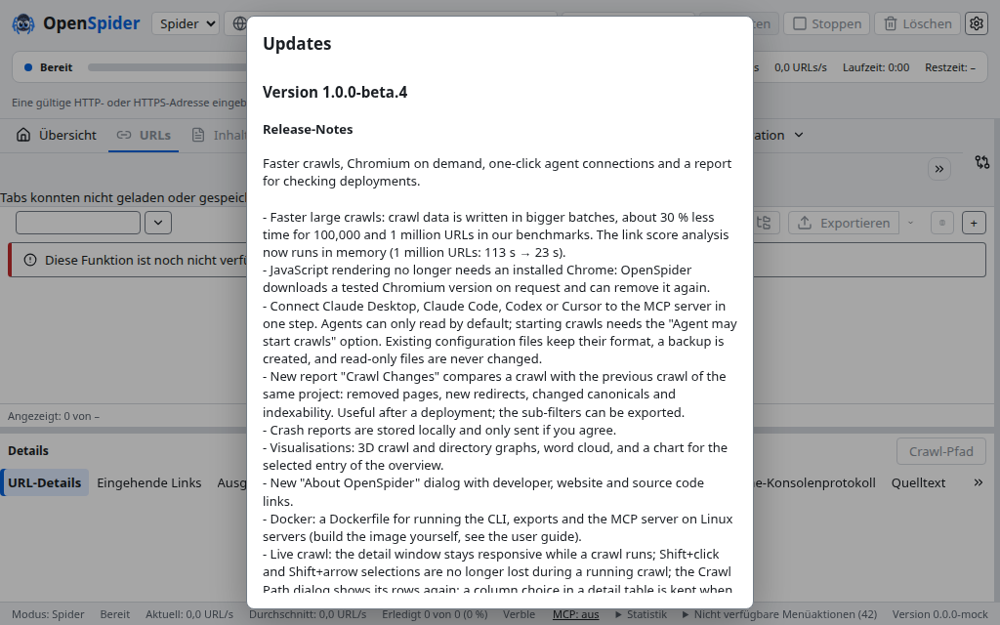
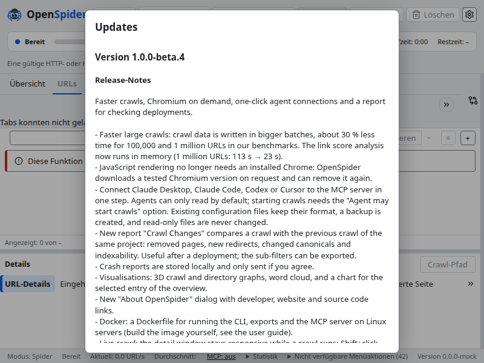
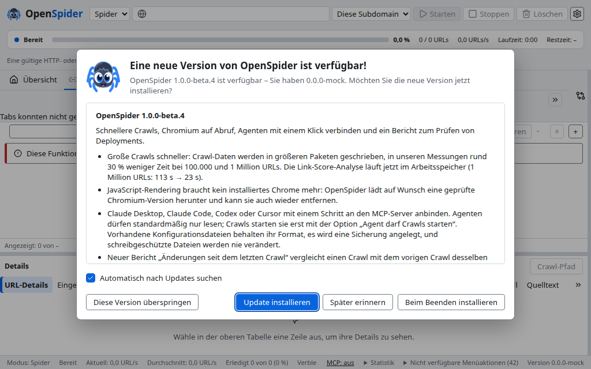
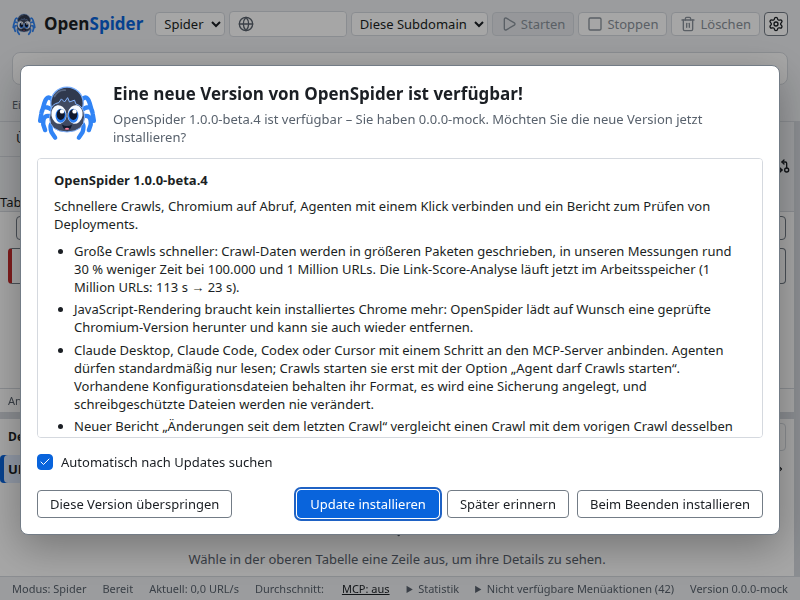
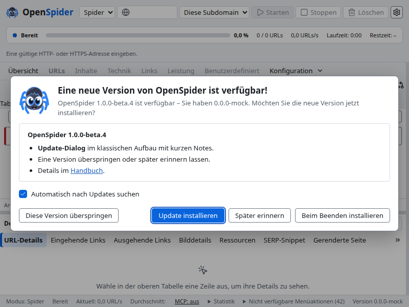

# B4-UPDDLG – Update-Dialog, kurze Update-Notes, Build-Nummer

Stand: 09.11.2026, Branch `m3/upddlg` ab lokalem `main` (`17689124`), Mac-Worktree `~/Projects/openspider-wt/c-upddlg`, Server-Worktree `m3-upddlg`. Kein Push.

Auftrag in drei Schritten (Orchestrator, alle 09.11.): (1) Knöpfe einzeilig, Notes gerendert und je Sprache; (2) Nutzervorgabe: Aufbau wie ein klassischer macOS-Update-Dialog, „Diese Version überspringen“/„Später erinnern“, kurze Update-Notes im Manifest; (3) Build-Nummer in App, CLI und Release-Workflow.

## Vorher / Nachher

Playwright (Chromium, Linux-Server, Fake-Bridge), Oberfläche Deutsch, bereitstehendes Update mit den veröffentlichten beta.3-Notes.

| | 1024×640 | 800×600 |
|---|---|---|
| Vorher (`main`) |  |  |
| Nachher, beta.3-Notes (lang, Altbestand) |  |  |
| Nachher, kurze Update-Notes (ab beta.4) | |  |

Vorher: rohes Markdown, Englisch und Deutsch hintereinander, „### Deutsch“ als Text, Knöpfe im scrollenden Inhalt unterhalb der Notes (im Bild gar nicht sichtbar). Nachher: Kopf mit App-Symbol, Notes-Kasten scrollt für sich, nur der deutsche Teil als Liste, Kontrollkästchen, eine Knopfreihe.

Das Linux-Chromium meldet die Plattform als Windows, daher steht der Primärknopf dort zuerst (Fußleisten-Muster 5.6: Windows OK zuerst, macOS rechts außen).

## Wichtiger Befund zum Update-Test

Den Update-Dialog zeigt immer die **installierte** Version. Beim Test beta.2 → beta.3 war das der Dialog von beta.2; die einzeiligen, gestapelten Knöpfe aus B3-UI (`fedec433`) stecken erst in beta.3. Genauso zeigt beim Update beta.3 → beta.4 noch der beta.3-Dialog die Notes roh an. Der neue Dialog erscheint erstmals beim Update **von beta.4** auf die folgende Version. Für beta.3 → beta.4 hilft nur, dass das beta.4-Manifest künftig die kurzen Notes trägt (wenige Zeilen statt der langen Liste; „### Deutsch“ bleibt dort sichtbar).

## Umsetzung

### Dialog (OUT-251, `apps/desktop/src/features/update/**`)

- Kopf über ein neues optionales `icon` der Dialog-Primitive (`ui/primitives/Dialog.tsx`, rückwärtskompatibel): App-Symbol (Marke hell/dunkel wie „Über“), fett „Eine neue Version von OpenSpider ist verfügbar!“, darunter „OpenSpider <neu> ist verfügbar – Sie haben <installiert> (Build n). Möchten Sie die neue Version jetzt installieren?“. Der Dialogtitel ist zugleich der zugängliche Name.
- Notes-Kasten: Überschrift „OpenSpider <Version>“, `max-height` und eigenes Scrollen, per Tab fokussierbar (Tastatur-Scrollen, axe `scrollable-region-focusable`).
- Kontrollkästchen „Automatisch nach Updates suchen“, verbunden mit der vorhandenen Einstellung `updates.check` (`update.set_auto`). Siehe Spec-Fragen.
- Knopfreihe als Dialog-Fußleiste (`os-dialog-footer`, wie `DialogFooter`): links „Diese Version überspringen“, rechts „Später erinnern“, „Beim Beenden installieren“ und Primärknopf „Update installieren“. Reihenfolge nach Plattform wie die übrigen Dialoge (macOS Primär rechts außen, Windows zuerst). `white-space: nowrap`; ist das Fenster zu schmal, bricht die Reihe als Ganzes um, nie ein Knopf. Bei 800 px passen de und en in eine Reihe (gemessen).
- „Beim Beenden installieren“ ist in OUT-251 Pflicht (Beschreibung und Kriterium); es bleibt als zweiter Sekundärknopf. „Jetzt installieren und neu starten“ heißt jetzt „Update installieren“ (gleiche Aktion, `install({when:"now"})`).
- Installationsknöpfe aktiv, sobald der Hintergrund-Download fertig ist; vorher Fortschrittsbalken. Fehler beim Download: Primärknopf „Im Hintergrund herunterladen“. Laufender Crawl: „Nach Crawl-Ende installieren“ ersetzt beide Installationsknöpfe (OUT-251/CRAWL-142).
- Zustände ohne Update (Suche, aktuell, deaktiviert, Fehler) zeigen wie bisher nur den Status mit „Schließen“ (und „Erneut suchen“ bei Fehler) in derselben Fußleiste.
- Fokus (UI-126): Primärknopf beim Öffnen fokussiert (vor fertigem Download „Später erinnern“), Tab bleibt im Dialog, Esc schließt wie „Später erinnern“, Fokus kehrt zum Auslöser zurück.

### Notes-Baustein (gemeinsam mit B4-WHATSNEW)

`apps/desktop/src/features/update/notes.tsx`: `splitNotes`, `notesForLanguage` (Deutsch → Teil unter `### Deutsch`, sonst Englisch, Regel aus OUT-257) und `NoteMarkdown`. `NoteMarkdown` ist der Renderer aus `m3/whatsnew` (`WhatsNew.tsx`), übernommen und ergänzt um `del`, `escape`, Bilder als Text und eine einstellbare Überschriftenebene: nur React-Textknoten und eine Element-Erlaubnisliste, HTML wird als Text gezeigt, nur `http(s)`-Links, die über `openInBrowser` im Standardbrowser öffnen.

### Überspringen / Später erinnern

- `updates.skipped_version` in `settings.toml` (os-model, DTO, TS-Typ optional, Schema, DTO-Fixture). „Diese Version überspringen“ schreibt die Version per `settings.set` und schließt.
- `run_check_with_context`: Bei einer automatischen Prüfung ergibt die übersprungene Version „aktuell“ (kein Manifest gemerkt, kein Download). Eine neuere Version wird wieder gemeldet; die manuelle Prüfung zeigt auch die übersprungene.
- „Später erinnern“ schließt nur. Die nächste reguläre Prüfung (Start, höchstens einmal je 24 h, OUT-250) meldet das Update wieder. Ein bereits geladenes Paket installiert nichts von selbst (`install` nur auf Wahl).

### Kurze Update-Notes

- Format am Anfang von `docs/release/notes/<Version>.md`: `<!-- update -->`, englische Liste, `### Deutsch`, deutsche Liste, `<!-- /update -->`. Je Sprache 3 bis 6 einzeilige Punkte, höchstens 160 Zeichen. Beschrieben in `docs/release/release-rhythmus.md`, Vorlage `docs/release/notes-template.md` (bewusst außerhalb von `notes/`, damit sie weder geprüft noch von B4-WHATSNEW eingebettet wird).
- `scripts/release/notes.mjs`: `<Version> <Update-Notes>` schreibt nur den kurzen Abschnitt in die Datei, die `manifest.mjs` als `notes` liest; `--body` und `--changelog` nehmen die ausführlichen Notes ohne den Abschnitt; `--check` prüft beides und bricht ab 1.0.0-beta.4 ohne kurzen Abschnitt ab. Bis beta.3 gilt der Altbestand (ausführliche Notes im Manifest); `docs/release/notes/1.0.0-beta.3.md` ist unverändert. Vor dem Bau existierte keine getrennte Update-Notes-Quelle: der Parameter `<Update-Notes>` war nur die Ausgabedatei mit den vollständigen Notes.
- Eine Vorlage für beta.4 liegt nicht unter `notes/1.0.0-beta.4.md`, damit niemand eine halbe Datei committet; Mittwoch die Vorlage kopieren.

### Build-Nummer (UI-127, OUT-181)

- `crates/os-model/src/build_number.rs` (Regeln, ohne Ein-/Ausgabe) und `crates/os-model/build.rs`: `OPENSPIDER_BUILD_NUMBER` hat Vorrang (ungültig → Build bricht ab), sonst bei Release-Builds `git rev-list --count HEAD`, aber nur bei vollständigem Checkout des eigenen Repositorys (`--is-shallow-repository` = `false`, `--show-toplevel` = Workspace). Ohne Git, im flachen Checkout und in Debug-Builds: keine Nummer. Debug-Builds fragen Git bewusst nicht, sonst würde jeder Commit den ganzen Workspace neu bauen (os-model liegt ganz unten).
- os-model statt os-app, weil App und CLI es brauchen und `os-cli` nicht von `os-app` abhängt; außerdem legt B4-WHATSNEW gerade `crates/os-app/build.rs` neu an.
- Anzeige: `AppInfo.buildNumber` (optional), „Über“ („Version 1.0.0-beta.3 (Build 2578) · Commit <hash>“; vorher „· Build <hash>“, um zwei „Build“ zu vermeiden), Debug-Info (Zeile Version), Diagnose (`buildNumber`, `versionDisplay` in `system_info`), Update-Dialog (installierte Version mit Build, neue ohne, weil das Manifest sie nicht kennt), CLI `openspider 1.0.0-beta.3 (Build 2578, <hash>, <os>-<arch>)`; ohne Nummer unverändert.
- Release-Workflow: `prepare` (hat schon `fetch-depth: 0`) ermittelt die Nummer einmal, bricht bei flachem Checkout oder ungültiger Zahl ab und gibt sie als Output an `macos`, `windows` (neuer Input `build_number` in `release-macos.yml`/`release-windows.yml`) und `linux-core` (Job-Env) weiter; alle Plattformen bekommen dieselbe Zahl. Die Plattform-Workflows exportieren sie als `OPENSPIDER_BUILD_NUMBER` und sind innerhalb von „Release orchestration“ ohne Nummer rot (Einzelläufe der Plattform-Workflows bauen ohne). `linux-core` prüft zusätzlich, dass `openspider --version` „(Build <n>, “ ausgibt.

## Kriterium → Test → Ergebnis

Alle neuen Tests tragen `// spec: OUT-251` bzw. `UI-127`/`OUT-181`/`UI-126`/`UI-121`.

| Kriterium | Test | Ergebnis |
|---|---|---|
| Notes nach Oberflächensprache: de → Teil unter `### Deutsch`, en/es/fr/it → Englisch; CRLF, ohne Marker, leerer DE-Teil | Vitest `notes.test.tsx` mit den echten beta.3-Notes (`tests/fixtures/update-notes/1.0.0-beta.3.md`); `UpdateHost.test.tsx` de/en/es | bestanden |
| Liste gerendert (11 Punkte beta.3 in de/en/es), Fettdruck, Links im Standardbrowser | Vitest `notes.test.tsx`; Playwright `layout.spec.ts` (de, 11 `li`, kein „### Deutsch“, Kasten scrollt) | bestanden |
| Kein HTML ausgeführt (Script, Bild, iframe, `onerror`, `javascript:`/`data:`-Links) | Vitest `notes.test.tsx`; Playwright `update.spec.ts` (kein `script` im Dialog) | bestanden |
| Kopf, installierte Version mit Build, Kontrollkästchen, vier Aktionen | Vitest `UpdateHost.test.tsx` | bestanden |
| Knöpfe einzeilig (`getClientRects` je Beschriftung eine Zeile, Höhe < 2 Zeilen, kein Abschneiden), alle im Dialog, kein Überlauf von Seite und Dialog | Playwright `layout.spec.ts`, de/en/es/fr/it × 800×600 und 1024×640 × Chromium/WebKit; es/fr/it zusätzlich mit längeren Beschriftungen | 20 Fälle je Engine bestanden; de/en in einer Reihe |
| Tastatur: Primärknopf fokussiert, Tab bleibt im Dialog und erreicht Notes-Kasten und alle Knöpfe, Esc schließt, Fokus zurück, Enter installiert; axe ohne critical/serious | Playwright `layout.spec.ts` (de/en × Chromium/WebKit); axe auch in `update.spec.ts` | bestanden |
| Überspringen speichert, automatische Prüfung still, manuelle zeigt, neuere Version wieder gemeldet; Später erinnern schließt nur | Rust `update_network::skipped_version_is_silent_for_automatic_checks_but_shown_by_a_manual_check`; Vitest; Playwright `skip this version …` | bestanden |
| Laufender Crawl: nur „Nach Crawl-Ende installieren“ | Vitest; Playwright `update.spec.ts` | bestanden |
| Kurze Update-Notes nur ins Manifest, ausführliche in Release-Text/CHANGELOG; `--check` rot ohne Abschnitt ab beta.4, 3–6 Punkte, eine Zeile, ≤ 160 Zeichen; beta.3 unverändert; Vorlage gültig | `tests/release/orchestration.test.mjs` (zwei neue Tests, CLI Ende-zu-Ende) | bestanden |
| Build-Nummer: Variable vor Git, ungültig → Fehler, Git nur Release + vollständiger eigener Checkout, ohne Git keine; Anzeigeform | Rust `os-model` Unit-Tests `build_number` (3); Einbettungstest `os-model/tests/build_number.rs` in drei Läufen (siehe Gates) | bestanden |
| Release-Workflow: prepare zählt im vollständigen Checkout, flacher Klon und fehlendes Git rot, Weitergabe an macos/windows/linux-core, Plattform-Workflows rot ohne Nummer im Release, Linux-CLI zeigt „(Build n, “ | `orchestration.test.mjs` (Schritte als Bash gegen Test-Repos mit 3 Commits und `--depth 1`-Klon) | bestanden |
| CLI-Version = App-Version aus `workspace.package.version`, alle Crates `version.workspace = true` | `cli_basics::version_has_the_documented_format`, `orchestration.test.mjs` | bestanden |
| Über/Debug-Info/Update-Dialog zeigen „1.0.0-beta.3 (Build 2578)“ | Vitest `help.test.tsx`, `UpdateHost.test.tsx` | bestanden |

## Spec-Fragen und Entscheidungen

1. **Kontrollkästchen:** Eine Einstellung „Updates künftig automatisch herunterladen und installieren“ gibt es in der Spec nicht (OUT-250 kennt nur „Automatisch nach Updates suchen“; der Download läuft nach OUT-251 ohnehin im Hintergrund, eine automatische Installation ist nicht spezifiziert). Das Kästchen ist deshalb mit der vorhandenen Einstellung verbunden und trägt ihren Spec-Text „Automatisch nach Updates suchen“. Soll es eine automatische Installation geben, braucht das eine Spec-Entscheidung (wann installieren, Crawl-Schutz, Neustart).
2. **Anrede:** Die Vorgabe nennt „du hast …. Möchtest du …“. Die App siezt durchgehend, auch im Update-Dialog selbst („Bitte laden Sie …“, „Ihre IP-Adresse“). Umgesetzt ist „Sie haben … Möchten Sie die neue Version jetzt installieren?“. Wenn „du“ gewollt ist, sind es zwei Zeilen in `features/update/i18n/de.ftl`.
3. **Überspringen und manuelle Prüfung:** Festgelegt (und in OUT-251 eingetragen), dass Hilfe → „Nach Updates suchen“ eine übersprungene Version trotzdem zeigt, damit man sie später installieren kann.
4. **Website:** Handbuch (de/en) nennt noch „Jetzt installieren und neu starten“. Nicht angefasst (Website-Änderungen gehen mit dem Release live); Folgeauftrag für die Website-Woche.
5. **es/fr/it:** Für den Update-Dialog gibt es noch keine Kataloge (B4-LANG), die Sprachen fallen auf Englisch zurück. Der Layouttest misst deshalb zusätzlich mit längeren es/fr/it-Beschriftungen, die in die Knöpfe geschrieben werden.

## Für B4-WHATSNEW (`m3/whatsnew`)

- `WhatsNew.tsx`: eigenes `NoteMarkdown` löschen und `import { NoteMarkdown } from "./notes"` verwenden (gleiches Verhalten; `headingLevel` bei Bedarf auf 3).
- Kurzer Teil: `notes_parser::split` muss vor dem Aufteilen den Abschnitt `<!-- update -->` … `<!-- /update -->` behandeln, sonst landen ab beta.4 die kurzen Punkte im englischen und die ausführlichen Notes im deutschen Teil (der Parser trennt an der ersten `### Deutsch`-Zeile, die im kurzen Abschnitt steht). Vorschlag: Zeilen `<!-- update -->`/`<!-- /update -->` suchen (getrimmt); ist der Abschnitt da, je nach gewünschter Anzeige dessen Inhalt (kurz) oder das Dokument ohne ihn (ausführlich) an `split` geben; ohne Abschnitt wie bisher. Regel und Prüfung stehen in `scripts/release/notes.mjs` (`splitNotesDocument`) und in `release-rhythmus.md`.
- Merge: Beide Pakete ergänzen `UpdateSettings` (os-model), `UpdateSettingsDto`, `settings.schema.json`, `AppSettingsDto.json` und `UpdateSettingsDto.ts` um je ein Feld an derselben Stelle (`last_started_version` bzw. `skipped_version`). Konflikt rein textuell, beide Felder behalten. `features/update/i18n/*.ftl`: meine Schlüssel stehen in der Mitte, die von B4-WHATSNEW am Ende, kein Konflikt erwartet. `crates/os-app/build.rs` lege ich nicht an.

## Gates

Server `m3-upddlg`, 09.11.2026, Stand `0178ec33` (gespiegelt per `srv-sync.sh`).

| Gate | Ergebnis |
|---|---|
| `npm ci` | Exit 0 |
| `npm run -w apps/desktop typecheck` | Exit 0 |
| `npm run -w apps/desktop test` | 124 Dateien, 1.059 Tests; im letzten Lauf 1 Fehler in `sidebar/overview-chart/OverviewChart.test.tsx` (fremd, Zeitverhalten unter Serverlast; einzeln 30/30 grün, im vorigen Gesamtlauf grün) |
| Playwright `e2e/update` (Chromium + WebKit) | 42/42; mit `--repeat-each=2` 84/84 nach der Fokus-Wartestelle (`0178ec33`; vorher 1 Ausreißer in 62 Läufen beim WebKit-Tastaturtest) |
| `node --test tests/release/orchestration.test.mjs` | 28 Tests, 27 grün; Test 12 (L01-Archive) scheitert auf dem Server auch auf unverändertem `main` mit Exit 127 (fehlendes Werkzeug), nicht von diesem Paket |
| `node scripts/lint-css.mjs`, `bash scripts/check-neutral.sh` | Exit 0 |
| `cargo fmt --all --check` | Exit 0 |
| `cargo clippy --workspace --all-targets -j 4 --locked -- -D warnings` | Exit 0 |
| `cargo test --workspace -j 4 --locked` (nach `~/ws-slot.sh`, `CARGO_PROFILE_DEV_DEBUG=0 CARGO_PROFILE_TEST_DEBUG=0 CARGO_INCREMENTAL=0`) | **4.508 bestanden, 0 fehlgeschlagen, 51 ignoriert**, 619 Suites, Exit 0 |
| Build-Nummer, Release-Profil mit Git | eingebettet = `git rev-list --count HEAD` des Server-Checkouts (Einbettungstest grün) |
| Build-Nummer, Release-Profil ohne Git (`GIT_DIR=/nonexistent`, eigenes Zielverzeichnis) | keine Nummer (grün) |
| `OPENSPIDER_BUILD_NUMBER=abc` | Build bricht ab: „OPENSPIDER_BUILD_NUMBER="abc" ist keine gültige Build-Nummer (positive ganze Zahl)“ |
| `OPENSPIDER_BUILD_NUMBER=2578` (Debug) | Einbettungstest und CLI-Formattest grün; `openspider 0.1.0 (Build 2578, bb0b27e126, linux-x86_64)` |

`target/`, `node_modules`, `apps/desktop/node_modules` und `apps/desktop/test-results` im Server-Worktree danach entfernt.

### Build-Nummer: Nachweis und Erwartung für beta.4

- Der Server-Wert ist kein Nachweis für die Release-Nummer: Der Server-Worktree steht auf `origin/main` (`bb0b27e1`, 2516 Commits); der lokale `main` ist 91 Commits weiter und nicht gepusht (2607 am 09.11.). Zum Vergleich: `v1.0.0-beta.3` = 2441.
- Gezählt wird im Release-Workflow `git rev-list --count HEAD` im Job `prepare`. Bei einem Tag-Push ist `HEAD` der Tag-Commit; bei `workflow_dispatch` ohne Probelauf prüft der vorhandene Schritt, dass der Tag-Commit gleich `HEAD` ist. Der Checkout hat `fetch-depth: 0`; meldet `git rev-parse --is-shallow-repository` nicht `false`, bricht `prepare` mit „Flacher Checkout: Build-Nummer wäre falsch“ ab. Eine ungültige Zahl ist ebenso rot. Die Zahl steht in der Run-Zusammenfassung. Die Plattform-Jobs bekommen sie nur als Output und zählen nicht selbst (ihre Checkouts sind flach).
- Erwartete Nummer für beta.4: `git rev-list --count v1.0.0-beta.4` des Tag-Commits auf dem Release-Branch, also mindestens 2607 plus alle bis Mittwoch nach `main` gemergten Commits und die Commits des Release-Branches (`set-version`, CHANGELOG). Vor dem Tag lässt sie sich nicht genau angeben. Nach dem Lauf den Wert der Run-Zusammenfassung mit dem lokalen `git rev-list --count v1.0.0-beta.4` vergleichen und in der App unter „Über“ sowie mit `openspider --version` gegenprüfen.
- Dass `openspider --version` hier `0.1.0` zeigt, ist richtig für diesen Stand: `main` steht zwischen Releases auf `0.1.0`, `set-version.mjs` setzt die Release-Version auf dem Release-Branch einmal für App und CLI (`workspace.package.version`; am Tag `v1.0.0-beta.3` steht `1.0.0-beta.3`). Kein zweiter Pflegeort; abgesichert durch die beiden Tests oben. Die Spec (OUT-181) widerspricht dem nicht.

## Fremde Dateien

- `apps/desktop/src/ui/primitives/Dialog.tsx`, `apps/desktop/src/ui/ui.css`: optionales Symbol im Dialogkopf (additiv).
- `apps/desktop/src/features/help/HelpDialogs.tsx`, `features/help/version.ts`, `features/help/i18n/*.ftl`: Version mit Build-Nummer in „Über“ und Debug-Info; `u04-about-build` von „Build {hash}“ auf „Commit {hash}“.
- `apps/desktop/src/features/help/help.test.tsx`, `licenses.test.tsx`: erwartete Zeile „· Commit fixture“ statt „· Build fixture“.
- `apps/desktop/src/i18n/language-audit.test.ts`: geprüfte Gleichlaute „Commit“ und die Vorlage „(Build )“ in die Ausnahmeliste (vorgesehener Mechanismus, K2-75).
- `crates/os-app/src/{dto/app.rs,runtime/info.rs,diag.rs}`, `apps/desktop/src/ipc/gen/AppInfo.ts`: `buildNumber`.
- `crates/os-cli/build.rs`, `crates/os-cli/tests/cli_basics.rs`: CLI-Version mit Build-Nummer; Formattest erlaubt das optionale „Build n, “.
- `.github/workflows/release.yml`, `release-macos.yml`, `release-windows.yml`, `tests/release/orchestration.test.mjs`.
- `docs/spec/05-ui.md` (UI-127), `docs/spec/06-output-ops.md` (OUT-251, OUT-181).

## Abschluss

**PAKET FERTIG** – Stand `0178ec33` auf `m3/upddlg` (13 Commits ab `17689124`), kein Push.

Merge-Schluss: Das ganze Paket einschließlich Build-Nummer ist fertig und grün, der Termin Di 18:00 wackelt nicht. Wenn die Build-Nummer trotzdem getrennt werden soll, sind das die Commits `551a8c25`, `665f750c`, `2ef8392e`, `91ca6165`, `d284cf17` und der Anteil von `a2e68713` (dieser setzt die Dialog-Commits voraus). Für den Release Mittwoch beachten: Ab beta.4 braucht `docs/release/notes/1.0.0-beta.4.md` den kurzen Abschnitt, sonst ist `prepare` rot. Vorlage: `docs/release/notes-template.md`.
